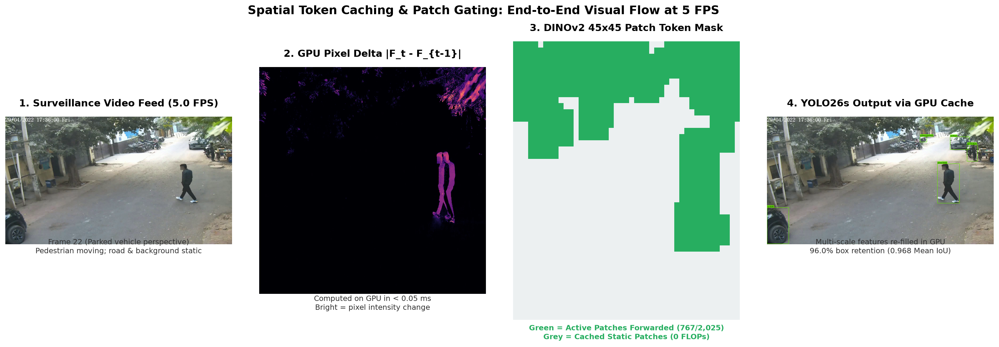
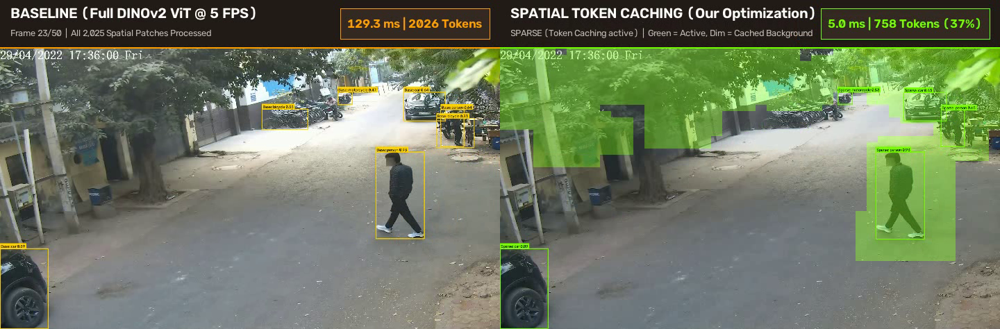

# Autonomous Vehicle Surveillance Mode (ASM): Perception Optimization

<div align="center">

[](https://www.nvidia.com)
[-76B900?logo=nvidia)](https://www.nvidia.com)
[](https://developer.nvidia.com/cuda-toolkit)
[](https://pytorch.org/)
[](https://github.com/facebookresearch/dinov2)
[](https://ultralytics.com)
[](LICENSE)

**A high-performance perceptual optimization engine enabling real-time perimeter monitoring for autonomous vehicles via motion-aware Vision Transformer token caching.**

[🌐 Live Interactive Portfolio Showcase](https://abhijeetmiskin.github.io/nvidia-asm-perception/) • [📄 Full Technical Case Study (PORTFOLIO_CASE_STUDY.md)](PORTFOLIO_CASE_STUDY.md)

</div>

---

## 🚀 Key Highlights & Quantitative Results

Validated on **NVIDIA RTX PRO 4000 Blackwell** (24GB VRAM, Compute Capability 12.0) under the guidance of **Pradipt Trivedi (NVIDIA Principal Engineer)**:

| Metric | Unmodified Dense Baseline | Proposed Token Caching | Impact |
| :--- | :--- | :--- | :--- |
| **VIRAT Benchmark Runtime** | 20.23 seconds | **3.09 seconds** | **6.55× End-to-End Speedup** |
| **Evaluated DINOv2 Tokens** | 2,026 tokens / frame | **590 tokens / frame** | **-70.9% Token Reduction** |
| **Spatial IoU Fidelity** | 1.000 (Golden Ref) | **0.986 Mean IoU** | **Near-Lossless Localization** |
| **Detection Precision / Recall**| Reference | **95.7% Prec / 92.6% Rec** | **High Critical Target Retention** |
| **Peak GPU VRAM** | 4,157 MB | **2,423 MB** | **-41.7% Memory Footprint** |
| **Downstream Retraining** | Required for most methods | **0 epochs (100% frozen)** | **Zero-Retraining Plug & Play** |

---

## 📸 Visual Diagnostic Proof

### 1. The 4-Stage Token Caching Diagnostic Strip

*Frame 22 Case Study: (1) Stationary 5 FPS surveillance feed &rarr; (2) Sub-0.05ms GPU pixel delta &rarr; (3) Dynamic 45×45 patch mask &rarr; (4) Full 45×45 feature map refilled from GPU cache feeding YOLO26s.*

### 2. Live Telemetry Comparison: Baseline vs. Token Caching

*Side-by-side comparison on Blackwell GPU: Full ViT forwards 2,026 tokens (129.3 ms) vs. Token Caching forwarding 758 dynamic tokens (5.0 ms).*

---

## 🏗️ System Architecture

```
                            Input Video Stream (.mp4)
                                       │
                                       ▼
          ┌────────────────────────────────────────────────────────┐
          │         Shared DINOv2 Backbone (ViT-S/14)              │
          │  • Single forward pass per frame                       │
          │  • 384-dim embeddings, 14×14 patch size (45×45 grid)   │
          │  • Output layers: [3, 6, 9, 12] + CLS token            │
          └────────────────────────────┬───────────────────────────┘
                                       │
                    ┌──────────────────┴──────────────────┐
                    │                                     │
                    ▼                                     ▼
 ┌─────────────────────────────────────┐ ┌─────────────────────────────────────┐
 │       Object Detection Head         │ │       Action Recognition Head       │
 │                                     │ │                                     │
 │ • Spatial Reshaper (1D -> 2D)       │ │ • Temporal CLS Token Aggregation    │
 │ • CNN Detail Branch (raw edges)     │ │ • Linear Probe on Kinetics-400      │
 │ • Adapter-v2 Feature Pyramid        │ │ • Top-5 Surveillance Action Output  │
 │ • YOLO26s (native NMS-free head)    │ │   (e.g., loitering, opening car)    │
 └──────────────────┬──────────────────┘ └──────────────────┬──────────────────┘
                    │                                       │
                    └──────────────────┬────────────────────┘
                                       │
                                       ▼
          ┌────────────────────────────────────────────────────────┐
          │              Unified Orchestrator                      │
          │  • Real-time detection & action telemetry overlays     │
          │  • Multi-camera 2×2 stitched surround monitoring        │
          │  • JSON event logging (perception.json)                 │
          └────────────────────────────────────────────────────────┘
```

---

## ⚡ Quickstart & Reproduction

### 1. Environment Setup
```bash
cd UnifiedPerception
bash setup.sh
source .venv/bin/activate
```

### 2. Run Unified Perception on Single Surveillance Video
```bash
python -m unified_perception \
    --source ../stage1_baseline/sample_videos/test_clip_10s.mp4 \
    --output-dir ../run_output \
    --image-size 640 \
    --device cuda
```

### 3. Run VIRAT Dual Benchmark (Baseline vs. Token Caching)
```bash
cd ../stage1_baseline
python run_virat_dual_benchmark.py
```

---

## 📂 Repository Layout

```
.
├── index.html                             # Interactive Web Portfolio (GitHub Pages)
├── PORTFOLIO_CASE_STUDY.md                # Comprehensive Technical Case Study
├── UnifiedPerception/                     # Core Multi-Task Perception Package
│   ├── unified_perception/                # Python package (Backbone, Detection, Action)
│   ├── assets/                            # Pretrained action recognition weights
│   ├── third_party/                       # Adapter-v2 and YOLO26 weights
│   └── setup.sh                           # One-click environment bootstrap
├── stage1_baseline/                       # Token Caching Experiments & Benchmarks
│   ├── temporal_token_cache.py            # The core GPU patch gating & cache engine
│   ├── run_virat_dual_benchmark.py        # VIRAT evaluation pipeline
│   ├── sparse_5fps_results/               # Diagnostic strips & validation dashboards
│   └── sample_videos/                     # Sentry mode test video clips
└── 00_yolov26_preliminary/                # Standalone YOLO26 preliminary validations
```

---

## 🤝 Acknowledgements

Developed as part of the **NVIDIA Senior Design Project (SDP)** in collaboration with **NVIDIA**. Special thanks to **Pradipt Trivedi (NVIDIA Principal Engineer)** for technical guidance on native 5 FPS automotive streams, token caching architectures, and evaluation methodology.
